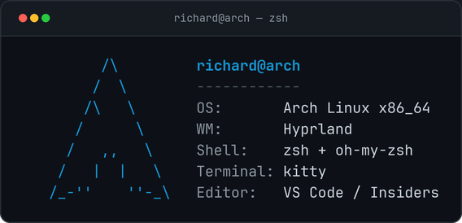

  

## 💻 Sobre mí

Soy estudiante de la **Licenciatura en Desarrollo y Gestión de Software** en la **Universidad Tecnológica de Panamá**. Me apasiona el código, los asistentes con IA y los sistemas personalizados.

- Desarrollo aplicaciones móviles, web y de escritorio.
- Construyo asistentes locales con IA (Ollama) y voz.
- Cuando no estoy estudiando, estoy configurando **Arch Linux**… una vez más.

 

  

## 🎓 Universidad

<table align="center">
  <tr>
    <td bgcolor="#0D1117" align="center" width="33%">
      
    </td>
    <td bgcolor="#0D1117" align="center" width="33%">
      
    </td>
    <td bgcolor="#0D1117" align="center" width="33%">
      
    </td>
  </tr>
</table>

## 🛠️ Tecnologías

### Lenguajes y desarrollo

  

### Herramientas y entorno

  

## 🚀 Proyectos destacados

<table>
  <tr>
    <td width="50%" align="center" valign="top" bgcolor="#0D1117">
      <h3><a href="https://github.com/Death272004/ZerotwoIA">ZeroTwoIA</a></h3>
      

        Asistente de escritorio local con voz e IA inspirado en Zero Two. Interfaz visual con chat, espectro tipo HUD, memoria local y modelo Ollama corriendo en tu PC.
      

      

        
        
        
      

      
    </td>
    <td width="50%" align="center" valign="top" bgcolor="#0D1117">
      <h3><a href="https://github.com/Death272004/Recetas-app">Recetas LID</a></h3>
      

        App Android que sugiere recetas según los ingredientes que ya tienes, prioriza opciones económicas y arma la lista de compras solo con lo que falta.
      

      

        
        
        
      

      
    </td>
  </tr>
  <tr>
    <td width="50%" align="center" valign="top" bgcolor="#0D1117">
      <h3><a href="https://github.com/Death272004/Brain-shell-config-linux-">Brain Shell</a></h3>
      

        Configuración completa de mi Arch Linux + Hyprland + kitty + zsh + fastfetch, lista para reproducir en cualquier PC.
      

      

        
        
        
      

      
    </td>
    <td width="50%" align="center" valign="top" bgcolor="#0D1117">
      <h3><a href="https://github.com/Death272004/DS7-Proyect">DS7 Proyect</a></h3>
      

        Proyectos de la materia Desarrollo de Software VII, desarrollados con enfoque web full-stack.
      

      

        
        
        
      

      
    </td>
  </tr>
  <tr>
    <td width="50%" align="center" valign="top" bgcolor="#0D1117" colspan="2">
      <h3><a href="https://github.com/Death272004/Proyectos-Personales">Proyectos Personales</a></h3>
      

        Compilación de proyectos académicos y personales acumulados durante la carrera en C, C++, Java y Python.
      

      
    </td>
  </tr>
</table>

## 📈 Actividad en GitHub

  
  
   
  
    
  
  

## 🤝 Contacto

  
  

 

### 💡 Configurando, construyendo y convirtiendo ideas en soluciones, un `commit` a la vez.

